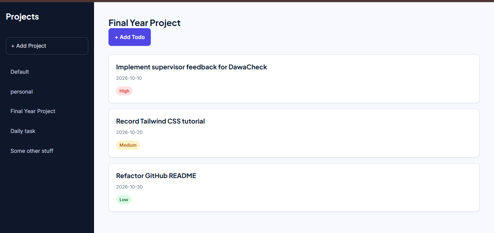
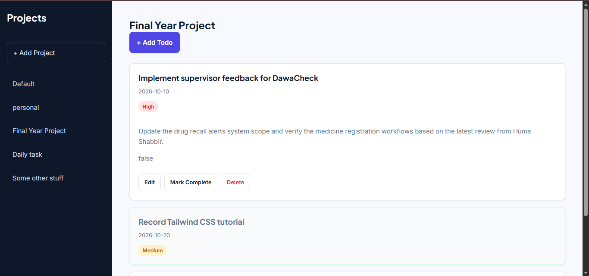

# Taskflow — Todo List

A project-based Todo List application built with vanilla JavaScript, HTML, and CSS. Taskflow helps you organize tasks into projects, set priorities and due dates, track completion, and keep your data saved between sessions.

## Preview

### Dashboard preview



### Dashboard preview with full card details



## Features

- **Project organization:** create projects and switch between them.
- **Task creation:** add a task with a title, description, due date, and priority.
- **Task editing:** update an existing task's details.
- **Completion tracking:** mark tasks complete or incomplete.
- **Task deletion:** remove tasks you no longer need.
- **Expandable task details:** open a task to view its details and available actions.
- **Priority indicators:** distinguish low, medium, and high priority tasks.
- **Persistent storage:** save projects and tasks in the browser's `localStorage`.
- **Input validation:** prevent blank project names and task titles, and reject duplicate project names.
- **Responsive interface:** adapt the layout for narrower screens.
- **Modular JavaScript:** keep task, project, storage, and DOM responsibilities separated.

## Built With

- HTML5
- CSS3
- JavaScript (ES modules)
- Webpack
- Browser `localStorage`
- Google Fonts: Inter and Plus Jakarta Sans

## Getting Started

### Prerequisites

Install a current version of [Node.js](https://nodejs.org/) and npm.

### Installation

1. Clone the repository or download the project source.
2. Open a terminal in the project directory.
3. Install the dependencies:

   ```bash
   npm install
   ```

4. Start the development server using the script configured in `package.json`:

   ```bash
   npm start
   ```

5. Open the local URL printed by the development server in your browser.

> If your `package.json` uses a different development script, run the script defined there instead.

## How to Use

1. Open Taskflow.
2. Select a project in the sidebar, or create a new project.
3. Choose **Add Todo** and enter a title. You can also provide a description, due date, and priority.
4. Select a task to expand its details.
5. Use **Edit** to update the task, **Mark Complete** or **Mark Incomplete** to change its status, and **Delete** to remove it.
6. Refresh the page to verify that saved projects and tasks remain available.

## Project Structure

The project uses ES modules to separate the main application entry point, data models, project management, storage, and DOM rendering. The structure below describes the files used in the current implementation; adjust names if your local project differs.

```text
src/
├── dom/
│   ├── sidebar.js       # Project sidebar rendering and interactions
│   └── todoList.js      # Task rendering, adding, editing, completion, deletion
├── index.js             # Application entry point
├── project.js           # Project factory
├── projectManager.js    # Project and task operations
├── storage.js           # localStorage persistence
├── template.html        # HTML template
├── todo.js              # Todo factory
└── style.css            # Application styling
|___preview/
    ├── taskflow-1.png
    └── taskflow-2.png

package.json
webpack.config.js
README.md
```

## Data Persistence

Taskflow uses the browser's `localStorage` to persist application data. Data is stored locally in the browser rather than in a remote database. Clearing the browser's site data can remove saved Taskflow data.

## Screenshots

To add the two previews:

1. Run the app and arrange the window at desktop width.
2. Capture a screenshot that shows the sidebar and task list; save it as `preview/taskflow-desktop.png`.
3. Resize the browser to a mobile/narrow width and capture the responsive layout; save it as `preview/taskflow-mobile.png`.
4. Commit the screenshots with the README.

Use genuine screenshots of your running app so the README accurately represents the current implementation.

## The Odin Project Requirements Checklist

The checklist below maps the commonly specified Todo List project requirements to the features implemented in this project. Verify each item against your final code before marking it complete.

- [x] Use JavaScript objects/factories or equivalent modules to represent todos and projects.
- [x] Include task properties for title, description, due date, and priority.
- [x] Allow users to create projects and select/switch between projects.
- [x] Add new tasks to the selected project.
- [x] Allow tasks to be edited.
- [x] Allow tasks to be marked complete or incomplete.
- [x] Allow tasks to be deleted.
- [x] Expand a task to view its details.
- [x] Separate application/data logic from DOM rendering code.
- [x] Store projects and tasks in `localStorage`.
- [x] Load saved data when the application starts and provide a default project when no saved projects exist.
- [x] Use CSS and responsive layout styling for the interface.
- [ ] Confirm storage recovery handles missing or malformed saved data safely.
- [ ] Confirm all user input and edge cases are tested, including empty values and duplicate project names.
- [ ] Add the desktop and mobile screenshots referenced above.
- [ ] Complete a final browser test for console errors, responsive behavior, and all task/project actions.

> The checked items reflect the functionality described during development. The unchecked items are final verification tasks; do not mark them complete until you have tested them in your current version.

## Future Improvements

Possible enhancements, if you choose to add them later:

- Filter tasks by completion status or due date.
- Sort tasks by priority or due date.
- Add keyboard-friendly task interactions and improved focus management.
- Replace browser prompts with an in-app project creation form.
- Add automated tests for project management and storage behavior.

## Acknowledgements

Built as a learning project while working through The Odin Project JavaScript curriculum.
