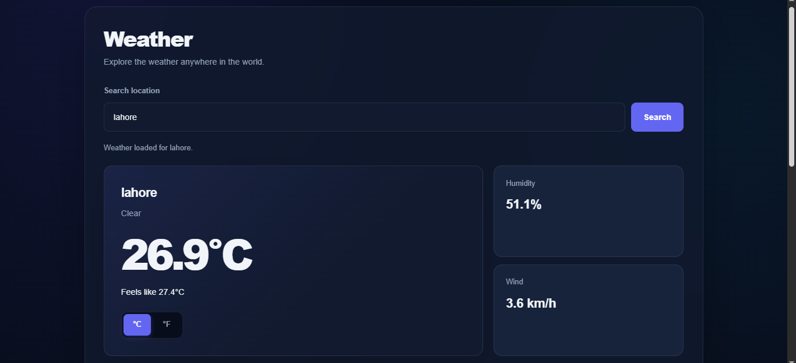
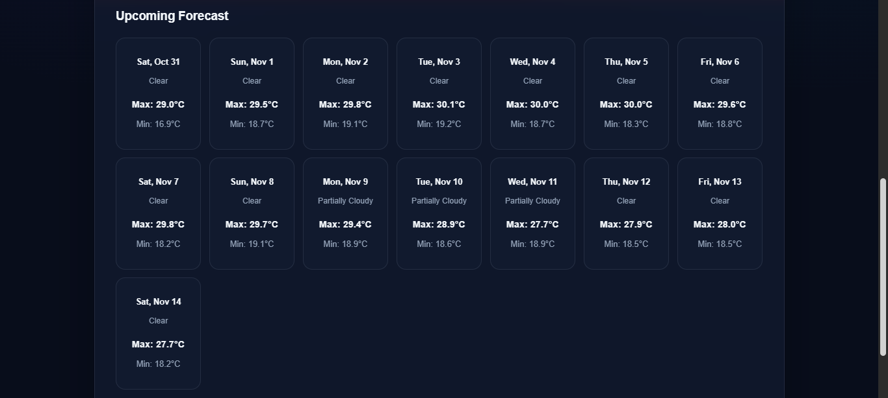

# 🌤️ Weather App

A responsive weather application built with **HTML, CSS, and JavaScript**. It allows users to search for locations around the world, view current weather conditions, and explore upcoming forecasts.

The application uses the **Visual Crossing Weather API** to retrieve real-time weather information and forecast data.

## 📸 Project Preview

### Main Weather Dashboard



### Upcoming Weather Forecast



## ✨ Features

- **Search Locations:** Find weather information for cities around the world.
- **Current Weather:** Display location, weather conditions, temperature, and feels-like temperature.
- **Temperature Conversion:** Switch between Celsius and Fahrenheit.
- **Weather Details:** View humidity and wind speed.
- **Upcoming Forecast:** Display daily forecast information, including weather conditions and maximum/minimum temperatures.
- **Dynamic Weather Styling:** Change background styling according to weather conditions.
- **Loading and Error Handling:** Provide feedback while fetching weather data and when requests fail.
- **Responsive Design:** Optimized for desktop, tablet, and mobile devices.
- **Accessible Controls:** Includes semantic HTML, form labels, and accessible status updates.

## 🛠️ Technologies Used

- HTML5
- CSS3
- JavaScript (ES6+)
- Visual Crossing Weather API
- Webpack
- npm
- Git & GitHub

## 📂 Project Structure

```text
05-weather-app/
│
├── src/
│   ├── index.js
│   ├── weather.js
│   ├── style.css
│   └── template.html
│
├── screenshots/
│   ├── weather-dashboard.png
│   └── weather-forecast.png
│
├── .env
├── .gitignore
├── package.json
├── package-lock.json
├── webpack.config.js
└── README.md
```

## ⚙️ Getting Started

Follow these steps to run the project locally.

### 1. Clone the repository

```bash
git clone https://github.com/Noorullah814/the-odin-project.git
```

### 2. Navigate to the project directory

```bash
cd the-odin-project/javascript/05-weather-app
```

### 3. Install dependencies

```bash
npm install
```

### 4. Configure the API key

Create a `.env` file in the project directory and add your Visual Crossing API key:

```env
WEATHER_API_KEY=your_api_key_here
```

You can obtain an API key from [Visual Crossing](https://www.visualcrossing.com/weather-api/).

Ensure your environment configuration is correctly handled by your Webpack setup. Never commit your actual API key to GitHub.

### 5. Start the development server

```bash
npm start
```

Open the local development URL provided by your Webpack setup.

## 🧠 What I Learned

Through this project, I practiced:

- Working with third-party APIs using `fetch()`.
- Handling asynchronous JavaScript with `async/await`.
- Managing API responses and errors.
- Validating external API data.
- Dynamically creating and updating DOM elements.
- Separating API logic from application and display logic.
- Converting temperatures between Celsius and Fahrenheit.
- Building responsive layouts with CSS Grid and Flexbox.
- Managing project dependencies and bundling with Webpack.
- Organizing and maintaining a project with Git and GitHub.

## 👨‍💻 Author

**Noor Ullah**

IT Student | Frontend Developer

- GitHub: [@Noorullah814](https://github.com/Noorullah814)
- Portfolio: [noorullah814.github.io/portfolio](https://noorullah814.github.io/portfolio/)

---

*Built as part of The Odin Project JavaScript curriculum.*