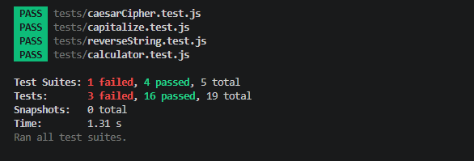
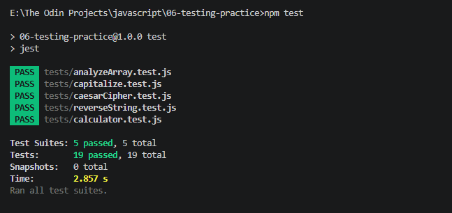

# Testing Practice – JavaScript

A JavaScript testing project completed as part of [The Odin Project](https://www.theodinproject.com/) curriculum. This project focuses on writing unit tests with **Jest** and applying the Test-Driven Development (TDD) approach to build and verify JavaScript functions.

## Overview

The project contains five JavaScript assignments, each implemented with corresponding Jest test cases.

The main goal was to understand how unit testing works, write meaningful test cases, identify errors, and ensure that functions behave as expected.

## Features

The project includes the following functions:

### 1. Capitalize
- Capitalizes the first character of a string.
- Returns an empty string when given an empty string.

### 2. Reverse String
- Reverses the characters of a string.
- Handles uppercase and lowercase characters.
- Handles single-character and empty strings.

### 3. Calculator
An object containing four mathematical operations:
- `add()` – Adds two numbers.
- `subtract()` – Subtracts one number from another.
- `divide()` – Divides two numbers.
- `multiply()` – Multiplies two numbers.

### 4. Caesar Cipher
- Shifts alphabetic characters by a specified number.
- Preserves uppercase and lowercase letters.
- Wraps characters around the alphabet.
- Preserves spaces and punctuation.
- Supports a shift factor of zero.

### 5. Analyze Array
Analyzes an array of numbers and returns an object containing:
- `average` – Average of all numbers.
- `min` – Smallest number.
- `max` – Largest number.
- `length` – Number of elements.

Also handles empty arrays by returning `null` for average, minimum, and maximum.

## Technologies Used

- JavaScript (ES6+)
- Jest
- Babel
- Node.js
- npm

## Project Structure

```text
06-testing-practice/
│
├── src/
│   ├── capitalize.js
│   ├── reverseString.js
│   ├── calculator.js
│   ├── caesarCipher.js
│   └── analyzeArray.js
│
├── tests/
│   ├── capitalize.test.js
│   ├── reverseString.test.js
│   ├── calculator.test.js
│   ├── caesarCipher.test.js
│   └── analyzeArray.test.js
│
├── babel.config.js
├── package.json
├── package-lock.json
└── README.md
```

## Getting Started

### Prerequisites

Make sure you have Node.js and npm installed.

### Installation

1. Clone the repository:

```bash
git clone https://github.com/Noorullah814/the-odin-project.git
```

2. Navigate to the project directory:

```bash
cd "the-odin-project/javascript/06-testing-practice"
```

3. Install the dependencies:

```bash
npm install
```

### Run Tests

Execute the following command to run all Jest test suites:

```bash
npm test
```

## Test Results

The project contains **19 test cases across 5 test suites**.

### 1. Initial Test Failure (Red Phase)

During development, the tests for `analyzeArray()` initially failed because the function had not yet been implemented and exported. The other four test suites passed.



### 2. Final Test Success (Green Phase)

After implementing all five functions, all test suites passed successfully.



**Final Test Summary:**

```text
Test Suites: 5 passed, 5 total
Tests:       19 passed, 19 total
Snapshots:   0 total
```

## What I Learned

Through this project, I practiced:

- Writing unit tests using Jest.
- Understanding test assertions such as `toBe()` and `toEqual()`.
- Applying Test-Driven Development (Red-Green workflow).
- Using JavaScript array methods such as `reduce()`.
- Working with string methods and character codes.
- Handling edge cases and validating function outputs.
- Organizing JavaScript source files and test files separately.
- Configuring Jest with Babel for ES module support.

## Author

**Noor Ullah**

[GitHub Profile](https://github.com/Noorullah814)

## Acknowledgment

This project was completed as part of [The Odin Project – JavaScript Course](https://www.theodinproject.com/paths/full-stack-javascript/courses/javascript).